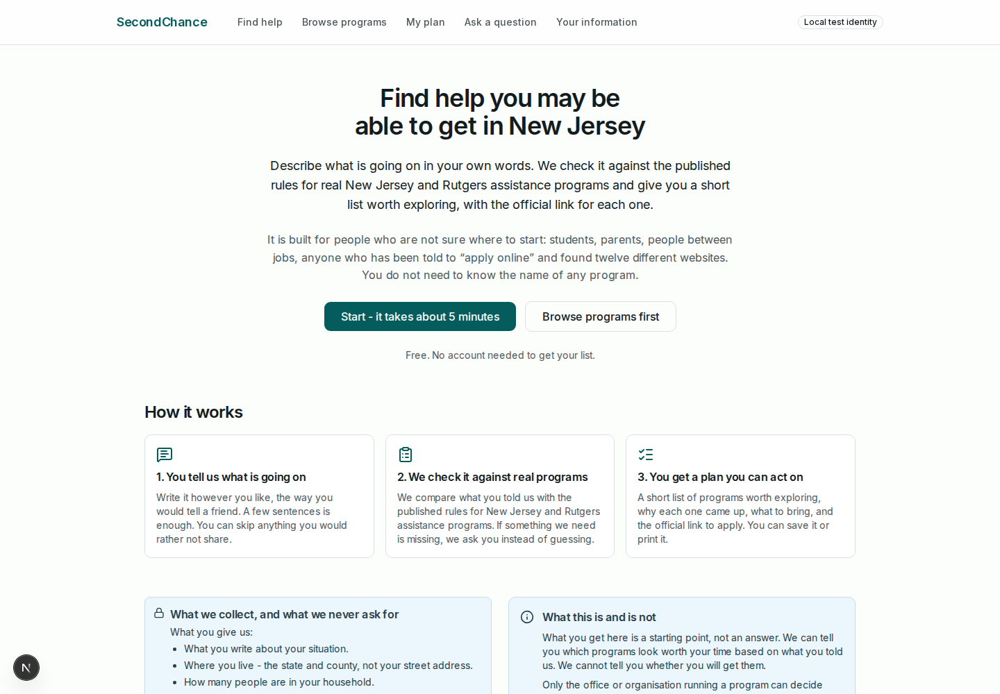
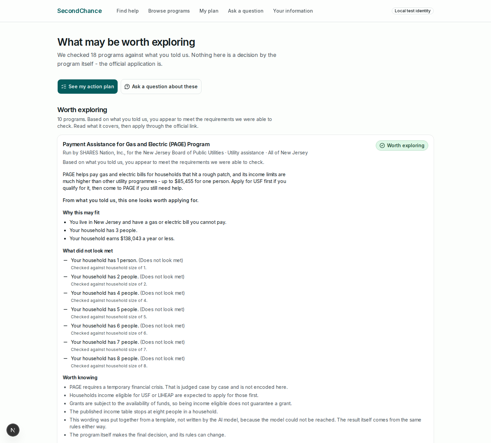
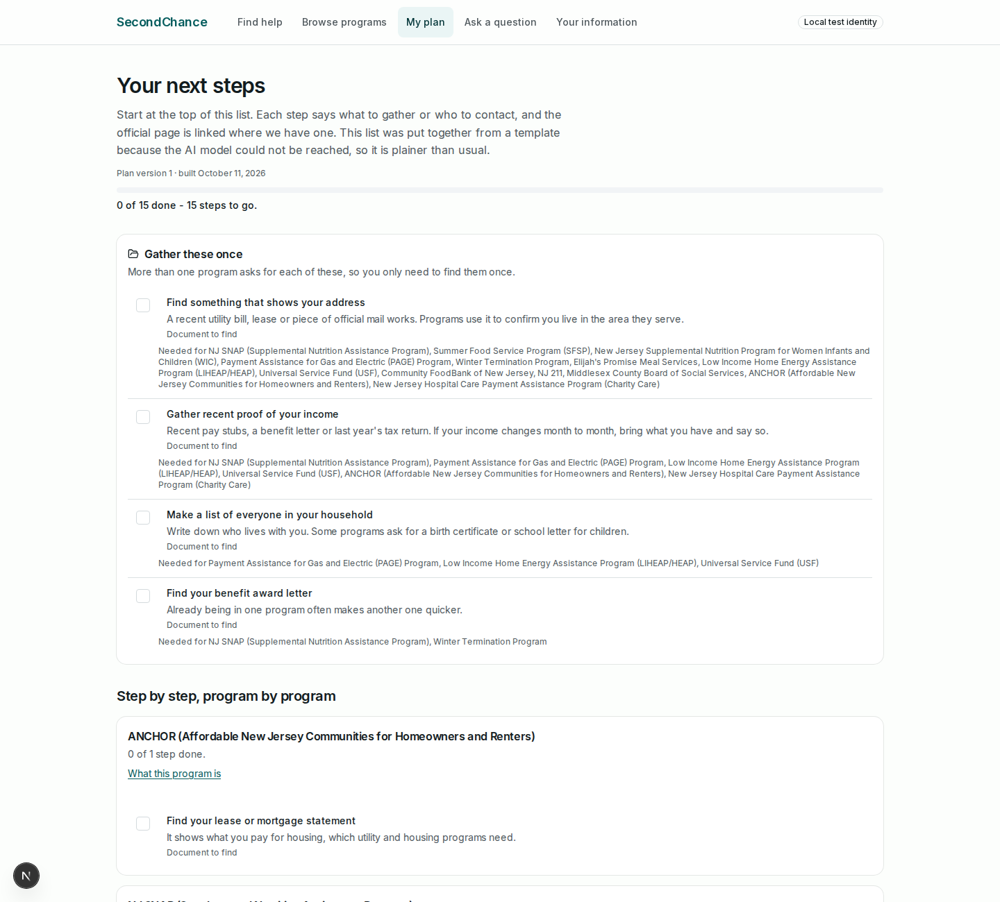

# SecondChance

An AI benefits navigator for New Jersey and Rutgers.

Someone describes their situation in their own words - "I live in New Brunswick with my two kids, I work part time and make about $2,000 a month, I need help with groceries and my electric bill".
SecondChance reads that into a structured profile, asks only the questions whose answers would change the outcome, checks a curated catalog of real assistance programs, and returns a plain-language list of what may be worth exploring plus a step-by-step action plan with official links.

It is an independent student project. It is not a government agency and it is not affiliated with one.





## Why you can trust the output

**The model never decides anything.**
A deterministic rule engine compares the profile against each program's encoded requirements and returns one of exactly three statuses: `POTENTIAL_MATCH`, `MORE_INFO_NEEDED`, `UNLIKELY_MATCH`.
Gemini only writes the wording around a status that has already been decided.
When Gemini is unreachable the statuses are identical - only the prose gets plainer, and the page says so.

**Nothing says "eligible".**
Only the office running a program can decide that.
The UI says "worth exploring", "need a bit more info" and "probably not a fit", and every result links to the official page to apply.

**Every claim is traceable.**
Each program carries its official source and the excerpt the rule was read from.
A program whose source could not be verified is marked `NEEDS_REVIEW` and is excluded from eligibility claims rather than guessed at.
Follow-up questions in the assistant are answered only from stored sources; if there is no source, it says so instead of inventing one.

**It asks for as little as possible.**
State and county, household size, a rough income range, and what kind of help is needed.
Never a Social Security number, never bank or card details, never an immigration document number - there is nowhere in the app to type them.
Income amounts, narratives, emails and tokens are redacted before anything is logged.

## Stack

- **Backend** - Python 3.12, FastAPI, SQLAlchemy 2 on asyncpg, Alembic, structlog. LangGraph for the workflow, with a Postgres checkpointer so a run that pauses for a question survives a restart.
- **Model** - Google Gemini through `google-genai`, used only for narrative extraction, explanation wording and chat answers.
- **Database** - Postgres 16 in Docker, with row-level security policies on every user-scoped table.
- **Frontend** - Next.js 16 and React 19, Tailwind 4, shadcn/Radix, TypeScript strict. API types are generated from the backend's OpenAPI schema, so a contract change is a type error.
- **Auth** - Supabase, verified as JWTs server side. Locally it runs in `AUTH_MODE=dev` with a per-browser stub identity.

## Running it locally

You need Docker, Node 22 and [uv](https://docs.astral.sh/uv/). You do **not** need `make` - every recipe lives in the `./do` script, and `make` is only a thin wrapper for machines that happen to have it.

```bash
cp .env.example .env            # then fill in GEMINI_API_KEY; the rest has working local defaults
./do install                    # backend/.venv on CPython 3.12, plus frontend deps
./do db-up                      # Postgres 16 on localhost:5433
./do migrate                    # alembic to head, on the app and test databases
./do seed                       # load the curated program catalog (idempotent)
./do dev-api                    # http://localhost:8000
./do dev-web                    # http://localhost:3000
```

`./do help` lists every target. The ones worth knowing:

```bash
./do e2e        # drives the whole product over HTTP and asserts 14 transitions
./do test       # full backend suite with coverage
./do lint       # ruff + eslint
./do typecheck  # mypy --strict + tsc --noEmit
./do verify     # everything CI runs
./do bench      # latency and cost over the golden scenarios
```

`./do e2e` is the honest proof that it works. It asserts 14 steps in about 1.3 seconds: the catalog is reachable without signing in, a narrative becomes a structured profile, starting a check returns a durable id, the run pauses to ask the one question that would move it, answering resumes it from its checkpoint, matches come back with evidence and only the three statuses, the action plan collapses documents that several programs both want, ticking a step off is durable, editing the profile re-checks only what the edit could change, a follow-up is answered only from stored sources, a prompt-injection attempt changes no status, every model call is recorded, and deleting the account leaves no user rows behind.

## Known limitations

- **The catalog is small and hand-curated.** 25 programs: 23 with a verified official source, 2 still marked `NEEDS_REVIEW`. It covers food, utilities, housing, healthcare and Rutgers-specific aid in New Jersey, and nothing else. There is no automated refresh, so a program that changes its rules goes stale until someone re-checks it.
- **Program rules are simplified.** Income thresholds and household rules are encoded; "a temporary financial crisis", caseworker discretion and funding availability are not, and the UI lists them as things it could not check rather than pretending otherwise.
- **Results are preliminary, always.** The app cannot tell anyone whether they will receive help.
- **The Gemini path degrades rather than fails.** If the model is unreachable the app falls back to deterministic templates and quoted source excerpts, and labels every such answer. That is the intended behaviour, but it means a broken key looks like plainer writing rather than an error.
- **Supabase auth is implemented but not yet exercised against a live project.** Local development runs on `AUTH_MODE=dev`, which trusts an `X-Dev-User` header and is not a security boundary.
- **No browser test suite yet.** `./do e2e` covers the API journey; the UI has been driven by hand at 1440px and on mobile widths, not by Playwright. `./do e2e-web` is wired up and waits for a suite to exist.
- **Not deployed.** It runs locally only.
