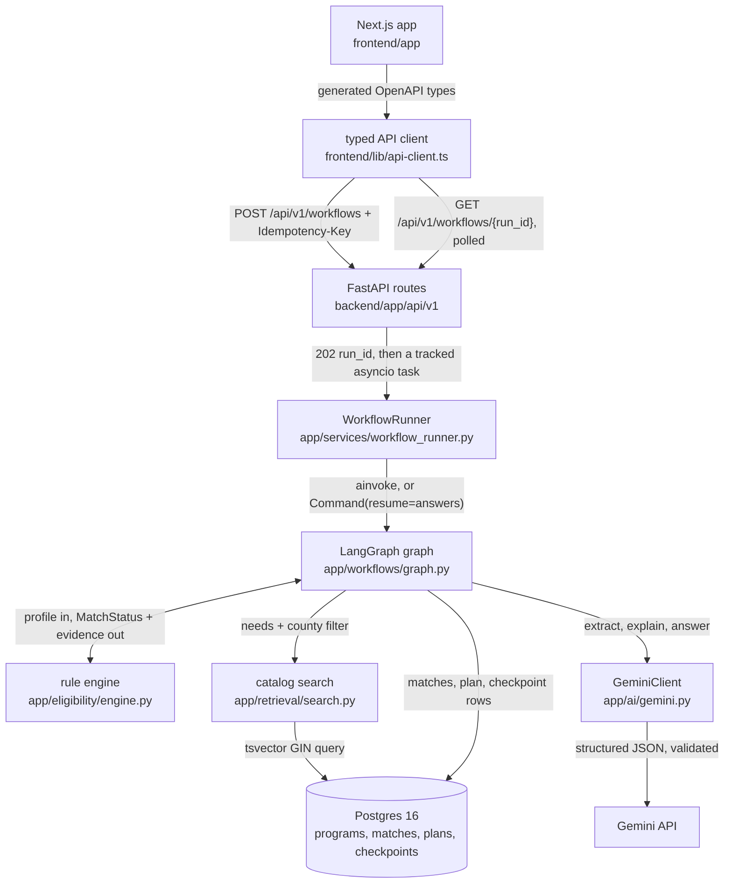

# SecondChance

An AI benefits navigator for New Jersey and Rutgers assistance programs.

## What it does

The interesting constraint in benefits navigation is that the model must not be allowed to answer the question.
If a language model decides who qualifies for food assistance, it will eventually tell a struggling family they qualify when they do not, and that family wastes a day at a county office.
So in SecondChance the model is structurally incapable of deciding anything: no Gemini response schema can express a match status, and a test asserts it.
A deterministic rule engine reads the encoded requirements and returns one of exactly three verdicts.
Gemini only writes the sentences around a verdict that has already been decided.

Someone types their situation in their own words, something like "I live in New Brunswick with my two kids, I work part time and make about $2,000 a month, I need help with groceries and my electric bill".
That becomes a structured profile, the rule engine compares it against a curated catalog of real programs, and the result is a plain-language list of what may be worth exploring plus an action plan with official links and the documents to gather.

Income is stored as a range rather than a figure, and the engine uses three-valued logic, so a range that straddles a program's threshold resolves to `MORE_INFO_NEEDED` instead of a guess.
The set of fields that caused an unknown is exactly the set of questions worth asking, which is why clarification questions are generated by the engine and not by the model.
Nothing in the UI ever says "eligible", because only the office running a program can decide that.

It is an independent student project, not a government agency and not affiliated with one.


## Tech stack

Backend is Python 3.12 on FastAPI 0.143, SQLAlchemy 2.1 over asyncpg, Alembic for migrations, structlog for JSON logging with a redaction processor.
LangGraph 1.2 runs the workflow, with `langgraph-checkpoint-postgres` so a run that pauses for a question survives a process restart.
Gemini is reached through `google-genai` 2.29 and used only for narrative extraction, explanation wording, and chat answers.

Data lives in Postgres 16, with row-level security policies on every user-scoped table and a generated `tsvector` column for catalog search.
Frontend is Next.js 16 and React 19 with Tailwind 4, shadcn/Radix primitives, and TypeScript in strict mode.
Its API types are generated from the backend's OpenAPI schema, so a contract change surfaces as a type error rather than a runtime 422.
Auth is Supabase, verified server side against the project's ES256 JWKS; locally it runs in `AUTH_MODE=dev` with a per-browser stub identity.

## Architecture



Posting a narrative returns `202` and a run id immediately, then the runner executes the graph in a bounded asyncio task with its own database session.
The graph extracts a profile, fans out to catalog search and evidence validation in parallel, joins, and hands the profile to the rule engine, which is the only component allowed to produce a status.
If a missing field blocks a verdict the graph calls `interrupt()`, the runner stores the questions and marks the run `AWAITING_INPUT`, and the browser keeps polling until someone answers.
Resuming replays from the Postgres checkpoint on the same thread id, so a different process can finish a run it never started.

## What building this taught me

**The model provider died mid-build and the architecture absorbed it.** Gemini started returning `403 PERMISSION_DENIED` on every generation call, which should have been fatal for an AI product, but statuses were already deterministic so only the prose degraded. I added a shared cool-off so requests stop re-dialing a provider already known to be down, and relabeled the output `fallback` so the API reports which text came from a model and which did not.

**Concurrent LangGraph branches needed a custom reducer, not `operator.add`.** Both fan-out stages write shared list fields like `missing_fields`, and `operator.add` silently duplicated entries whenever two parallel nodes contributed the same field, so a user got asked the same question twice. The fix was a `merge_unique` reducer plus a rule that every other state field has exactly one writing node, which makes the parallelism safe by construction rather than by review.

**Modeling "unknown" as a real value removed the need for the model to guess.** Storing income as a nullable number forced a binary answer to "does this person meet the threshold" even when the honest answer was that nobody knew. A range plus three-valued logic means a straddling range resolves to unknown and the blocking fields fall out of evaluation, so clarification questions stopped being a prompt and became a database query.

## Known limitations

The catalog is small and hand-curated: 25 programs, 23 with a verified official source and 2 still marked `NEEDS_REVIEW` and excluded from eligibility claims.
It covers food, utilities, housing, healthcare and Rutgers-specific aid in New Jersey, and nothing else.
There is no automated refresh, so a program that changes its rules goes stale until someone re-checks it; `./do` has a source verifier that re-fetches each page and compares a content hash, but running it is a manual step.

Program rules are simplified. Income thresholds and household composition are encoded, while caseworker discretion, funding availability and "a temporary financial crisis" are not, and the UI lists those as things it could not check rather than pretending otherwise.
Results are preliminary in every case; the app cannot tell anyone whether they will actually receive help.

Supabase auth is implemented and verified against a live project's JWKS, but the app currently runs in `AUTH_MODE=dev`, which trusts an `X-Dev-User` header and is not a security boundary.
`./do e2e` covers the API journey and asserts 14 transitions in about 1.3 seconds; the UI has been driven by hand at desktop and mobile widths but has no Playwright suite yet, so `./do e2e-web` is wired up and waiting for one.
There is no CI workflow in the repo, and nothing is deployed. It runs locally.

## Documentation

- [docs/INTERFACES.md](docs/INTERFACES.md) is the frozen contract between modules: the REST route table with request and response schema names, the LangGraph state fields and which node owns each one, the database tables and columns, and the shared error envelope.
- [docs/TOOLCHAIN.md](docs/TOOLCHAIN.md) records the verified API surface of the pinned libraries, including which LangGraph and `google-genai` imports were confirmed by introspection rather than assumed, and the results of probing Gemini model availability.

## Quick start

You need Docker, Node 22, and [uv](https://docs.astral.sh/uv/). You do not need `make`: every recipe lives in the `./do` script, and the Makefile is a thin wrapper for machines that happen to have it.

```bash
cp .env.example backend/.env   # then fill in GEMINI_API_KEY; the rest has working local defaults
./do install                   # backend/.venv on CPython 3.12, plus frontend deps
./do db-up                     # Postgres 16 on localhost:5433
./do migrate                   # alembic to head, on the app and test databases
./do seed                      # load the curated program catalog, idempotent
./do dev-api                   # http://localhost:8000
./do dev-web                   # http://localhost:3000
```

`./do help` lists every target. The ones worth knowing are `./do e2e` to drive the whole product over HTTP, `./do test` for the full backend suite with coverage, `./do verify` for lint plus typecheck plus tests, and `./do types` to regenerate the frontend types from the OpenAPI schema.
